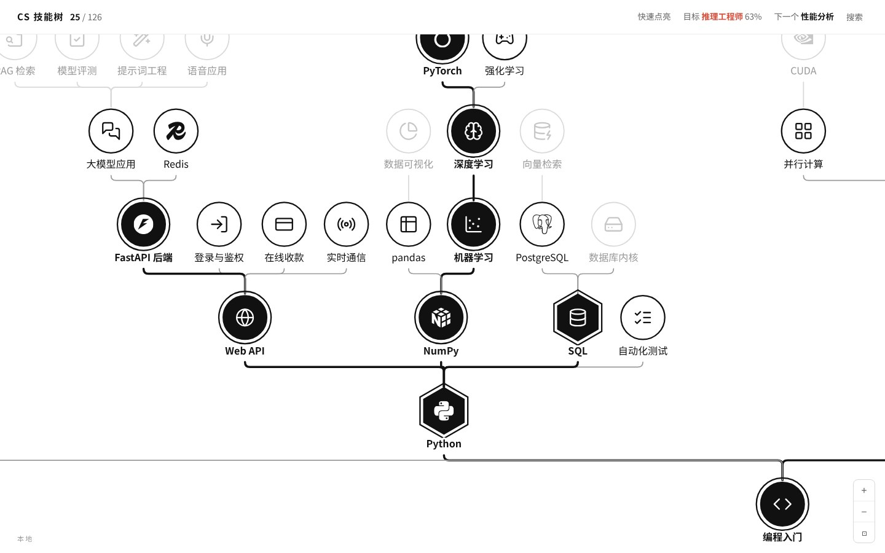

# cs-skill-tree

简体中文 | [English](docs/README.en.md)

**一棵像游戏天赋树的 CS 技能树：点亮你会的，看你离 17 个岗位还差几个技能。**

👉 https://theowang42.github.io/cs-skill-tree/


- **离岗位还差几个**：首页一圈 17 个岗位，点一个就长出它要学的技能；点几个你会的，马上算出还差几个
- **169 个技能，9 个领域**：地基、Web 开发、客户端与游戏、底层系统、安全、数据与量化、机器学习、大模型、AI Infra，按学的先后排。一个领域一棵天赋树，前置都点亮了才能点亮下一个
- **每个技能都写清楚**：一句“会……，能……”的掌握标准，4 到 6 步学习流程（每步能单独点亮），标好类型和是否免费的学习资源
- **每个岗位一棵树**：只画这个岗位要学的技能，比如 [后端开发工程师](https://theowang42.github.io/cs-skill-tree/career/backend/)、[大模型算法工程师](https://theowang42.github.io/cs-skill-tree/career/llm-algo/)
- **不用注册**：进度只存在你的浏览器里，可以导出、导入、用链接分享



## 怎么用

1. 在首页挑一个想去的岗位，点“就学这个”
2. 进技能树，从“你”开始往外点，点到不会为止。那就是你现在的位置
3. 点亮一个技能前，可以先按学习流程一步步学，每步做完点一下

树会按屏幕自己选方向：电脑上多半往右长，手机上往上长。滚轮或拖动平移，按住 Ctrl / ⌘ 滚动或双指捏合缩放。选中技能时 `D` 点亮、`X` 取消，`Esc` 返回。

## 本地运行

需要 Node 22.18 以上，不用装数据库。

```bash
npm ci
npm run dev        # 开发服务器
npm test           # 体检内容，跑全部测试
```

## 改内容

内容都在 `content/`，一个技能、一个职业各一个 Markdown 文件。写法见 [CONTRIBUTING.md](CONTRIBUTING.md)。改完跑 `npm test`，内容体检会指出哪里不对。

数据库和前端结构见 [docs/ARCHITECTURE.md](docs/ARCHITECTURE.md)，美术规范见 [docs/ART.md](docs/ART.md)。课程主要参考 [csdiy.wiki](https://csdiy.wiki/)。

## 许可

代码用 [MIT](LICENSE)，`content/` 里的内容用 [CC BY-SA 4.0](content/LICENSE.md)：可以自由转载和改编，注明出处、改编后用同样的许可就行。
