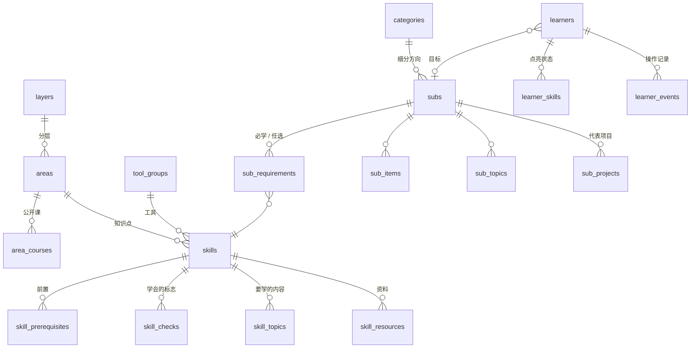

# 架构与修改指南

> 目标：**让一个学 CS 的人有一棵能点亮的技能树，随时知道自己的能力边界在哪里。**
>
> 这份文件说明项目由哪些部分组成、数据怎么流动、想改什么该去哪里改。

## 1. 核心概念

| 概念 | 含义 | 存在哪 |
| --- | --- | --- |
| **技能** | 树上最小的、能点亮的单位。`concept` 是知识点（属于某个知识领域），`tool` 是语言 / 框架 / 平台（属于某个工具组） | `skills` |
| **知识领域** | 一组相关的知识点，比如“操作系统”。20 个，分基础层、核心层、进阶层 | `areas`、`layers` |
| **前置** | 学 A 之前最好先会 B。整棵树是一张有向无环图 | `skill_prerequisites` |
| **学会的标志** | 2~3 条“做得到就算会了”的自测标准 | `skill_checks` |
| **方向** | 大方向（AI）下的细分方向（Agent 开发）。直接要求一组技能，前置自动带上；还可以有“任选其一”的组 | `categories`、`subs`、`sub_requirements` |
| **点亮** | 学习者把技能标成 `done`（已掌握）或 `learning`（在学） | 浏览器或 `learner_skills` |

每个技能对一个学习者有四种状态，后两种是推导出来的，不存：

| 状态 | 条件 | 页面上 |
| --- | --- | --- |
| `done` 已掌握 | 学习者标的 | 墨色填满 |
| `learning` 在学 | 学习者标的 | 填一半 |
| `available` 可以学了 | 前置全部 `done`，自己没标 —— **能力边界** | 蓝色实线框 + 蓝点 |
| `locked` 前置未满足 | 还有前置不是 `done` | 灰色虚线框 |

方向的**就绪度** = (必学闭包里已掌握的技能数 + 已满足的任选组数) / (必学闭包大小 + 任选组数)。

## 2. 数据怎么流动

```
db/migrations/*.sql   表、视图、触发器
db/seed/*.sql         全部内容（一个技能一行）
        │  npm run db:build：删库重建 → 灌内容 → 体检 → 导出
        ▼
data/cs-skill-tree.db ──► public/data/roadmap.json ──► 静态站点（GitHub Pages）
        │                                              进度存 localStorage，可导出 / 导入 / 分享
        └──► server/index.ts（API，零依赖）──► VITE_API=1 构建的前端
                                               进度、目标、操作记录存进数据库
```

- 运行时只用 Node 自带的 `node:sqlite` 和类型擦除，没有原生依赖，也不需要编译服务端代码。
- 前置闭包、学习顺序、四种状态、能力边界、就绪度都在**数据库视图**里实现；
  前端为了离线可用，在 `src/lib/tree.ts` 里有同样的算法，`tests/tree.test.ts` 用 25 份随机进度逐个比对两边的结果。

## 3. 数据库



| 迁移 | 内容 |
| --- | --- |
| `0001_content.sql` | 内容表。`STRICT` 表，CHECK 约束保证 id 格式、链接是 http(s)、知识点和工具的字段互斥 |
| `0002_graph_views.sql` | `skill_ancestors`（全部前置）、`skill_tiers`（领域内第几行）、`sub_skill_closure`（方向必学的全部技能）、`sub_learning_plan`（第几步学）、`sub_choices`、`skill_unlocks`、`skill_weight`（被多少技能依赖） |
| `0003_learners.sql` | `learners`、`learner_skills`、`learner_events`（三个触发器自动记录每次状态变化）；视图 `learner_skill_state`（四种状态）、`learner_frontier`（能力边界）、`learner_sub_readiness`（就绪度） |
| `0004_skill_depth.sql` | `skill_depth`（全局最长前置链）、`skill_level`（星图的 5 个等级：入门 / 基础 / 进阶 / 专精 / 前沿，由所在层和领域内层级映射，再按前置抬高，保证前置不在更高级）、`learner_reach`（每个领域点亮到第几圈） |

递归视图都用 `UNION` 去重，行数被限制在“节点数 × 深度”以内，数据里就算误写了环也能停下来，环由体检报错。

**重新播种不会丢学习者的进度**：内容表在一个事务里清空重灌，学习者表不动；指向已删除技能的记录会被清掉并报告数量。

## 4. 命令

| 命令 | 作用 |
| --- | --- |
| `npm run dev` | 重建数据库 + 导出 JSON + 启动 Vite，进度存浏览器 |
| `npm run dev:api` | 同时启动 API（3000）和 Vite（`/api` 代理过去），进度存数据库 |
| `npm run api` | 只启动 API；构建过 `dist/` 的话也会把页面一起发出去 |
| `npm run db:build` | 删库重建、灌内容、体检、导出 `public/data/roadmap.json` |
| `npm run db:check` | 只体检 |
| `npm run db -- stats` | 每张表多少行 |
| `npm run db -- events` | 最近的学习记录 |
| `npm run db -- query "SQL"` | 随手查，比如 `SELECT * FROM sub_learning_plan WHERE sub_id='backend' ORDER BY step` |
| `npm test` | 数据库、视图与前端算法的一致性、API、前端纯逻辑 |
| `npm run build` | 重建数据库 → 类型检查 → 打包到 `dist/` |

体检规则（`server/db.ts` 的 `check`）：

| 级别 | 规则 |
| --- | --- |
| 错误 | 外键、完整性、前置成环、前置指向更高的层（知识点不能依赖工具）、编号不连续、缺“学会的标志”/链接/公开课、方向没有必学技能、任选项已经是必学 |
| 提醒 | 多余的前置（已经是另一个前置的祖先）、多余的方向要求、孤立的知识点、没人用的工具、链接重复、介绍太长、热门方向太多 |

## 5. API

全部 JSON，见 `server/index.ts` 开头的列表。要点：

- `GET /api/roadmap` 和静态的 `roadmap.json` 完全一样
- `PATCH /api/learners/:id/skills` 批量改状态，在一个事务里；有一个不认识的技能就整批拒绝
- `GET /api/learners/:id/summary` 直接返回视图算出的状态计数、能力边界（目标里的排前面）、目标就绪度、最近的方向
- `GET /api/learners/:id/timeline` 按天汇总的成长记录（点亮、开始学、取消），来自触发器写的 `learner_events`
- `POST /api/learners/:id/import` 接受前端导出的进度文件，不认识的技能丢掉并在 `dropped` 里报告

## 6. 前端：技能树

```
src/
  types.ts              前后端共用的数据形状
  lib/tree.ts           索引、四种状态、能力边界、就绪度（和数据库视图同一套算法）
  lib/treeLayout.ts     技能树布局：行是等级、列是分支（纯函数，tests/treeLayout.test.ts）
  lib/areaIcons.ts      每个知识领域一个线条图标
  lib/store.ts          进度存储：LocalStore（浏览器）/ ApiStore（服务端），接口一样
  lib/search.ts         页面内搜索
  lib/share.ts          分享链接：已掌握技能的位图 → base64url
  state.tsx             全局状态和所有会改进度的动作（乐观更新、撤销、解锁动画、跳转请求）
  components/
    SkillTree.tsx       树本体：平移缩放、节点、线、点亮卡
    Hud.tsx             顶栏：进度、快速点亮、目标、下一个、搜索
    Panel.tsx           右侧面板路由：Dashboard / SkillPanel / AreaPanel / SubPanel / CategoryPanel
```

布局规则（`lib/treeLayout.ts`）：

- **行 = 等级**：五个带，由数据库视图 `skill_level` 算出。前置永远不在更低的带。
- **列 = 分支**：每个知识领域一列，相关的挨着。工具没有领域，跟着它最深的前置走。
- 每个分支在每一级上是一簇，簇按 `ceil(sqrt(n))` 列（最多 4 列）折行；带的高度由这一级最高的簇决定，分支的宽度由它最宽的簇决定。
- 簇内按前置在上一级的平均横坐标排序，线不交叉。

渲染和交互（`components/SkillTree.tsx`）：

- SVG。平移缩放不走 React，直接改世界 `<g>` 的 transform；只有缩放跨过档位时才 setState。缩得很小时隐藏节点名。
- 滚轮平移，Ctrl + 滚轮缩放，拖动平移，双指缩放。`0` 全图，`1` 我点亮的部分。
- 同一分支里的线一直画；跨分支的线只在选中或悬停时画。选中一个节点时画出它到根的全部前置（实线）和它解锁的节点（虚线），其余节点淡掉。
- 点节点：旁边弹出点亮卡（名字、状态、“点亮”/“在学”），右侧同时打开面板。前置没满足的节点给“连同 N 个前置一起点亮”。
- 顶栏“快速点亮”：点节点直接切换 没学 → 已掌握 → 在学。
- 设了目标后，最该学的那个节点上方有一个朱砂小三角；顶栏“下一个”跳过去。
- 面板只有一句话和链接，见 [ART.md](ART.md)。

进度的安全措施：

- 内容更新后，浏览器里存的、导入的、分享链接里带的已删除技能和方向会被清掉（`sanitize`），页面不会因为旧数据出错
- 两个标签页同时改进度不会互相覆盖：每次写之前重读 localStorage，并监听 `storage` 事件同步
- API 模式下所有请求排队发出，顺序和界面一致；只有服务器明确返回 404 才会新建学习者，断网或服务器重启不会把人换成空白身份
- 导入、清空、用分享链接覆盖都可以撤销；万一渲染出错，错误页提供备份进度和清空重试

## 7. 常见修改

- **加一个知识点**：在 `db/seed/2x_*.sql` 对应领域的 `INSERT INTO concept_rows` 里加一行（id、领域、名字、介绍、前置、学会的标志），跑 `npm run db:build`。
- **加一个工具**：`db/seed/30_tools.sql` 加一行；图标在 `src/lib/icons.ts` 里按 id 对应，Simple Icons 没有的写进 `MONOGRAMS`。
- **改方向要求**：`db/seed/40_directions.sql`，必学只写最高层的技能；任选组写成 `{"组名": ["a", "b"]}`。
- **加一个知识领域**：`db/seed/10_areas.sql` 加一行，再在技能文件里给它加技能。
- **改技能 id**：尽量别改，会让用户已有的进度和分享链接对不上。真要改，旧 id 的进度会在下次播种时被清掉。

## 8. 以后可以做

- 每个技能配几道自测题，答对才能点亮
- 按每个技能的预计学时估算离目标还要多久
- 和同一目标的人比较能力边界（数据库里已经有 `learner_events`，可以画成长曲线）
