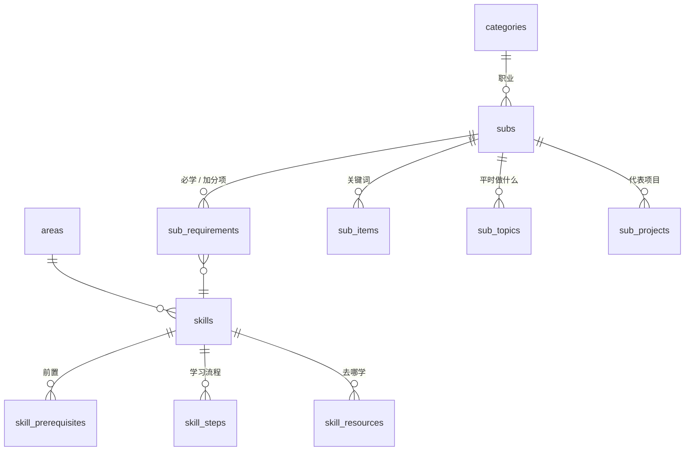

# 架构与修改指南

> 目标：**让一个学 CS 的人有一棵能点亮的技能树，随时知道自己的能力边界在哪里。**
>
> 这份文件说明项目由哪些部分组成、数据怎么流动、想改什么该去哪里改。

## 1. 核心概念

| 概念 | 含义 | 存在哪 |
| --- | --- | --- |
| **技能** | 树上能点亮的单位，每个都是一项能写进简历的能力。有一句话、学习流程（4 到 6 步）、去哪学 | `content/skills/*.md` |
| **领域** | 技能树上的一支，比如“底层系统” | `content/areas/*.md` |
| **前置** | 学 A 之前要先会 B。整棵树是一张有向无环图 | 技能文件的 `requires` |
| **职业** | 最外圈的徽章，属于某个大方向。直接要求一组技能，前置自动带上；还可以有不算进达成条件的加分项 | `content/categories/*.md`、`content/careers/*.md` |
| **点亮** | 进度就是“点亮了哪些技能”这个集合，加上没点亮的技能做完了学习流程的哪几步，存在浏览器里 | `localStorage` |

规则只有一条：**前置都点亮了才能点亮；熄灭一个，依赖它的一起熄灭**（`src/lib/tree.ts` 的 `plan`）。写了学习流程的技能，每一步都能单独点亮：最后一步做完，技能自动点亮；点亮了的技能取消其中一步，技能就熄灭（`src/state.tsx` 的 `setStep`）。每个技能有三种画法，都是从点亮集合推导出来的：

| 状态 | 条件 | 页面上 |
| --- | --- | --- |
| `done` 已点亮 | 点亮了 | 实心黑，外面一圈光芒 |
| `available` 能点亮 | 前置全部点亮，自己没点 —— **能力边界** | 黑框 |
| `locked` 够不着 | 还有前置没点亮 | 浅灰框 |

职业要学的全部技能（加分项不算）都点亮了，就自动达成。

## 2. 数据怎么流动

```
content/**/*.md    全部内容：一个领域、技能、大方向、职业各一个文件（写法见 CONTRIBUTING.md）
db/schema.sql      表和推导视图
        │  npm run data：读 Markdown → 在内存里建库 → 体检 → 导出
        ▼
public/data/roadmap.json ──┬──► 技能树（/tree/，单页应用），进度存浏览器，可导出 / 导入 / 分享
src/generated/icons.ts     └──► scripts/pages.ts：首页、每个技能一页、每个职业一页、sitemap
```

运行时只用 Node 自带的 `node:sqlite` 和类型擦除，没有原生依赖。数据库只在构建时存在，用完就扔。

## 3. 数据库



`db/schema.sql` 里的推导视图：

| 视图 | 算什么 | 用在哪 |
| --- | --- | --- |
| `skill_ancestors` | 每个技能的全部前置 | 下面几个视图、体检 |
| `skill_tiers` | 领域内第几行（只看同领域的前置） | 导出时技能的顺序，布局按这个顺序摆 |
| `skill_weight` | 有多少技能直接或间接依赖它 | “下一个学什么”的排序 |
| `sub_skill_closure` | 职业必学的全部技能 | 学习路线、“哪些职业要学它” |
| `sub_learning_plan` | 第几步学：没有前置的是第 1 步，其余是最晚的前置 + 1 | 职业页的学习路线 |

递归视图都用 `UNION` 去重并限制深度，数据里误写了环也能停下来，环由体检报错。

`scripts/content.ts` 读 `content/` 下的文件：开头 `---` 之间是属性，下面第一段是一句话，再往下是 `## 小节`。不认识的属性、小节、标签都报错，并指出文件和行号；引用的技能不存在、技能没列进任何领域，也在这一步报出来。`scripts/db.ts` 的 `build` 再把它们灌进表里：技能在领域里的顺序、职业在大方向里的顺序，就是领域和大方向文件里列表的顺序。

体检（`scripts/db.ts` 的 `check`），有错误时 `npm run data` 失败：

| 级别 | 规则 |
| --- | --- |
| 错误 | 前置成环、主前置不是真正的前置、徽章挂的技能不是必学的、技能没有链接、学习流程不是 4 到 6 步、写了学习流程但资源没标类型和是否免费、大方向下没有职业、职业没有代表项目、加分项已经是必学的 |
| 提醒 | 多余的前置、多余的必学要求、孤立的技能、没有职业用到的技能、一句话太长或不是“会……，能……”、名字太长放不下、链接重复 |

表约束另外挡住：id 格式、图标重复、前置指向自己、链接不是 https、资源类型不认识。`npm run data` 最后会报一共有几个技能写了学习流程。

## 4. 命令

| 命令 | 作用 |
| --- | --- |
| `npm run dev` | 导出数据，启动 Vite 开发服务器 |
| `npm run data` | 建库、体检、导出 `public/data/roadmap.json` 和 `src/generated/icons.ts` |
| `npm test` | 导出数据，再跑全部测试 |
| `npm run build` | 导出 → 类型检查 → 技能树打包到 `dist/tree/` → 生成首页、技能页、职业页到 `dist/` |

GitHub 上有两条自动检查：`Deploy to GitHub Pages` 每次推送都跑测试，推到默认分支时再发布；`Check links` 在内容改动时和每周一用 lychee 检查所有链接还能不能打开，坏了只标红，不挡发布。

## 5. 页面：首页、技能页、职业页

技能树是单页应用，搜索引擎看不到里面的内容。`scripts/pages.ts` 在打包时把同一份 `roadmap.json` 写成 HTML。同一个意思只有一个页面：技能页和职业页打开就是技能树，HTML 里写着同样的内容给搜索引擎，技能树的脚本加载后接管整页。

| 地址 | 内容 |
| --- | --- |
| `/` | 首页：一句话、演示短片、三步用法、全部职业路线、全部技能目录 |
| `/skill/<id>/` | 大图，这个技能的卡片已经打开：一句话、点亮、学习流程、去哪学 |
| `/career/<id>/` | 一个职业的天赋树：只画它要学的技能，竖着长，能直接点亮 |

| `/tree/` | 技能树本身；`#/skill/<id>`、`#/sub/<id>` 直接打开对应的卡片 |
| `/sitemap.xml` | 以上全部地址，提交给搜索引擎用 |

- 每页有自己的标题、描述、canonical 和面包屑（JSON-LD）。首页的图标在打包时用 React 渲染成 SVG 内联进去，不需要 JS。
- `site/` 里的文件（样式、短片和封面）原样复制到 `dist/`。`site/tokens.css` 是颜色和字体，技能树也用它。
- 技能树以前在首页：旧链接（`/#share=…`、`/#/skill/…`）打开首页时会自动转到 `/tree/`。

## 6. 前端：技能树

```
src/
  types.ts                roadmap.json 的形状
  generated/icons.ts      由 npm run data 生成：只 import 用到的图标（不进 git）
  lib/tree.ts             索引、三种状态、点亮规则、职业进度
  lib/webLayout.ts        布局：一个圆，从圆心往外一圈一圈长（tests/webLayout.test.ts）
  lib/careerLayout.ts     职业页的布局：只画一个职业要学的，竖着长，“你”在最下面、徽章在最上面
  lib/progress.ts         进度（点亮的技能 + 做了一部分的学习流程）存进浏览器、导出成文件、从文件导入
  lib/share.ts            分享链接：点亮的技能编成位图 → base64url
  state.tsx               全局状态和所有会改进度的动作（撤销、解锁动画、地址栏同步）
  components/
    SkillTree.tsx         技能树：同心圆、枝条、圆心的“你”、节点、最外圈的职业
    useCamera.ts          镜头：缩放、拖动、双指缩放、飞到某处
    glyphs.tsx            树和面板共用的画法：图标、光芒、六边形、技能槽
    Hud.tsx               顶栏：进度、达成了几个职业、下一个
    Panel.tsx             右侧面板：我的进度 / 技能 / 职业
```

布局（`lib/webLayout.ts`）：

- 树：每个技能挂在主前置（`parent`）上，职业挂在 `anchor` 上。其余前置不画线，选中时只让那些节点保持清楚。
- 一个圆：圆心 (0, 0) 是“你”，编程入门、Linux、微积分在第一圈，孩子在父亲外面一圈。圈与圈等距，第一圈在 `FIRST_RING`。职业在最外圈，就在它那一列的尽头。
- 角度：先紧凑地排，定下每一圈的先后顺序：子树按每一圈的左右轮廓紧挨着排（宽度换成弧度 = 像素宽 / 半径），父节点在孩子正中间。节点沿圆周占多宽看它在哪个方向（左右两边按名字宽，上下两边按节点加名字的高）。再摊开：节点被父亲拉着，同一圈挨得太近的按顺序推开、挪得最少（保序回归），最深最密的 AI 那几支往两边空的地方铺开；最后把单线的链能拉直的都拉直，只在挤的地方稍微拐一下。从 `RING` 开始一点点加大圈距，取第一个排得下、相邻两圈也不叠的。大模型算法工程师朝正上方，兄弟按领域排（`AREA_ORDER`）。
- 枝条从父节点沿半径往外，到两圈中间沿一小段圆弧转过去，再沿半径停在孩子前面；线绕开所有名字和节点（测试逐条检查）。

交互：

- 点节点：右侧面板打开（一句话、点亮按钮、学习流程、去哪学）。学习流程每一步点一下就点亮；做了一部分的技能，树上节点外圈画出一段实线。悬停或选中节点：它的全部前置画成黑的，其余变淡。
- 点职业：亮出它要学的全部技能，镜头缩到装下整条路线。
- 悬停圆心：只亮下一步能点亮的技能；点圆心打开“我的进度”。
- 镜头：最小缩放刚好装下整个圆；越放大能拖得越远，最外圈的徽章也能拖到屏幕正中。
- 美术规则见 [ART.md](ART.md)。

进度的安全措施：

- 内容更新后，浏览器里存的、导入的、分享链接里带的已删除技能和前置没点亮的记录会被清掉（`clean`），对不上步数的学习流程进度也清掉（`cleanSteps`）。分享链接只带点亮的技能，页面不会因为旧数据出错。
- 两个标签页同时开着，一边改了另一边跟着刷新（`storage` 事件）。
- 熄灭连带一串、导入、清空、用分享链接覆盖都可以撤销；万一渲染出错，错误页提供备份进度和清空重试。

## 7. 常见修改

- **加一个技能**：新建 `content/skills/<id>.md`，再把 id 加进领域文件的 `skills` 列表，跑 `npm run data`。写法见 [CONTRIBUTING.md](../CONTRIBUTING.md)。图标名不存在时直接报错。
- **改职业要求**：`content/careers/<id>.md` 的 `requires` 和 `bonus`。必学只写最高层的技能，第一个是徽章挂的位置。
- **加一个领域**：新建 `content/areas/<id>.md`，再在 `src/lib/webLayout.ts` 的 `AREA_ORDER` 里给它排个位置。
- **改技能 id**：尽量别改，会让用户已有的进度和分享链接对不上。真要改，旧 id 的进度会在下次加载时被清掉。

## 8. 以后可以做

- 每个技能配几道自测题，答对才能点亮
- 登录和跨设备同步进度
- 按每个技能的预计学时估算离一个职业还要多久
