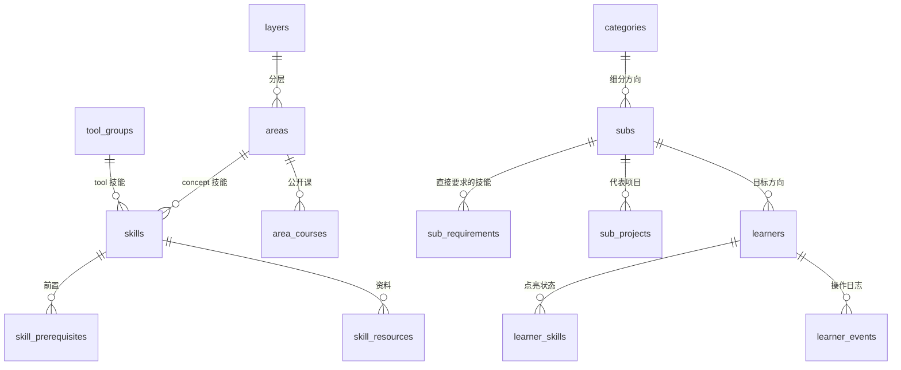

# cs-skill-tree 重做计划

> 目标一句话：**让一个学 CS 的人有一棵能点亮的技能树，随时知道自己的能力边界在哪里。**
>
> 这份文件既是计划也是进度表。每一阶段做完会在这里打勾并写明改了什么，方便之后修改。

## 1. 产品定义

| 概念 | 含义 |
| --- | --- |
| **技能（skill）** | 树上最小的一个点，比如“虚拟内存”“会用 Docker”。约 150 个。分两种：`concept`（知识点，属于某个知识领域）和 `tool`（语言 / 框架 / 平台，属于某个工具组）。 |
| **知识领域（area）** | 一组相关技能，比如“操作系统”“数据结构与算法”。17 个，分基础层 / 核心层 / 进阶层。 |
| **前置（prerequisite）** | 技能之间的有向边：学 A 之前最好先会 B。整棵树是一张有向无环图。 |
| **方向（direction）** | 职业 / 应用方向，先选大方向再选细分方向（AI › Agent 开发）。每个细分方向直接要求一组技能，前置自动带上，构成“要学的全部技能”和学习顺序。 |
| **点亮** | 学习者把一个技能标成 `done`，也可以先标成 `learning`。 |
| **能力边界（frontier）** | 所有前置都已点亮、但自己还没点亮的技能。这是“你现在就能学的东西”，也是树上“亮区”和“暗区”的交界。 |

每个技能对一个学习者有四种状态，前两种由数据推导：

| 状态 | 条件 | 画法 |
| --- | --- | --- |
| `locked` | 有前置还没点亮 | 灰、虚线边 |
| `available` | 前置都亮了，自己没亮（= 边界） | 白底实线边、微微呼吸 |
| `learning` | 学习者标的 | 半填充 |
| `done` | 学习者标的 | 实心点亮 |

选了目标方向后，树上另加一层信息：**目标需要的技能**用高亮描边，和点亮状态叠加，于是能一眼看到“为了这个方向，我亮了几个、边界在哪、还差几个”。

点亮不设硬门槛（自我评估要以真实为准）。点一个前置没亮的技能时，给出“连同 N 个前置一起点亮”的选项。

## 2. 架构

```
db/migrations/*.sql   表结构（SQLite，建表语句就是文档）
db/seed/*.sql         全部内容：领域、技能、前置、方向、资源。改内容只改这里
        │
        ▼  npm run db:build（重建 + 体检）
data/cs-skill-tree.db ──► npm run db:export ──► public/data/roadmap.json ──► 静态站点（GitHub Pages）
        │                                                                     进度存浏览器 + 可导出 / 导入文件
        └──► node server/index.ts（API，零依赖）──► 前端 VITE_API_BASE=/api 时走它
                                                   进度、目标、事件存进数据库，多设备同步
```

- 运行时只用 Node 22 自带的 `node:sqlite`，没有原生依赖，CI 和本地都不用编译。
- 树的逻辑（前置闭包、学习顺序、边界）在数据库视图里实现，前端只负责画。
- 前端两种模式共用同一套 `ProgressStore` 接口：`LocalStore`（localStorage + JSON 文件导入导出）和 `ApiStore`。

## 3. 数据库



视图（全部是递归 CTE，前端不算图）：

| 视图 | 回答的问题 |
| --- | --- |
| `skill_ancestors` | 某个技能的全部前置（直接 + 间接） |
| `sub_skill_closure` | 选了某个方向要学的全部技能 |
| `sub_learning_plan` | 这些技能第几步学（最长前置链） |
| `skill_unlocks` | 学会某技能后，哪些方向离你更近 |
| `learner_skill_state` | 每个学习者 × 每个技能的四态 |
| `learner_frontier` | 每个学习者现在的能力边界 |
| `learner_goal_readiness` | 离目标方向还差什么 |

## 4. 命令

| 命令 | 作用 |
| --- | --- |
| `npm run db:build` | 删掉旧库、建表、灌内容、体检 |
| `npm run db:check` | 体检：外键、成环、编号断档、没人用的内容、重复链接 |
| `npm run db:export` | 导出 `public/data/roadmap.json` |
| `npm run db -- query "SQL"` | 随手查 |
| `npm run api` | 启动 API（默认 3000） |
| `npm run dev` | Vite 开发服务器，`/api` 代理到 3000 |
| `npm test` | 单元测试（视图逻辑、API、导出形状） |
| `npm run build` | 重建库 → 导出 → 类型检查 → 打包 |

## 5. 前端

布局（桌面优先，窄屏可用）：

- **顶栏**：标题、总进度（已点亮 / 总数、边界数）、目标方向选择器、视图切换（全部 / 只看目标 / 只看边界）、搜索。
- **树**：从下到上 基础层 → 核心层 → 进阶层 → 工具层 → 应用层。每个领域是一张卡片，里面的技能按 tier 排成几列，领域内的前置连线画在卡片里；点中一个技能时，它的跨领域前置和被它解锁的技能连线高亮。
- **侧栏**：没选中时是“仪表盘”（目标进度、边界清单“你现在就能学”、最近点亮）；选中技能时是详情（介绍、前置及其状态、资料、能解锁什么、点亮按钮）；选中方向时是路线（分步骤列出要学的技能、每一步完成度）。
- **交互**：单击选中；点亮 / 在学 / 取消三态按钮；锁住的技能提供“连同前置一起点亮”；键盘 `/` 搜索、`Esc` 取消选中；首次访问有引导。
- **进度持久化**：本地模式自动存 localStorage，并提供“导出进度 / 导入进度”；API 模式自动同步，首次访问服务端发 id。

## 6. 阶段与进度

- [x] **阶段 0：数据库基础** — SQLite + 迁移 + 种子 + CLI + API 骨架（按原来的 17 个能力块建的，阶段 1 重做成技能粒度）
- [ ] **阶段 1：技能粒度的数据模型** — 重写迁移和种子：领域 → 技能，手写约 150 个技能和它们的前置；视图；体检规则
- [ ] **阶段 2：后端** — 学习者状态、边界、目标就绪度全部做成视图 + API；事件日志；测试
- [ ] **阶段 3：前端重做** — 新的树布局、四态渲染、连线、侧栏、仪表盘、搜索、引导
- [ ] **阶段 4：进度持久化** — LocalStore / ApiStore、导入导出、API 模式同步
- [ ] **阶段 5：打磨** — 动画、键盘、窄屏、深色模式、README、截图、CI

## 7. 改内容怎么改

- 加一个技能：在 `db/seed/20_skills.sql` 对应领域的 INSERT 里加一行，再在 `skill_prerequisites` 里写它的前置。跑 `npm run db:build`，体检会告诉你有没有写错。
- 加一个方向：`db/seed/30_directions.sql`，`sub_requirements` 只写最高层的技能。
- 看某个方向要学什么：`npm run db -- query "SELECT * FROM sub_learning_plan WHERE sub_id='backend' ORDER BY step"`

## 8. 以后可以做

- 每个技能加自测题（答对才能点亮）
- 多人对比：和同方向的人比边界
- 按学习时长估算距离目标还要多久
