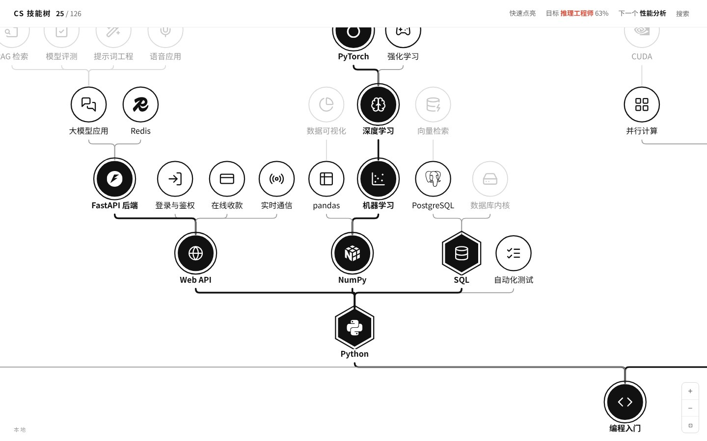

# cs-skill-tree

[简体中文](../README.md) | English

**A circular computer science skill tree: light up what you know and see how far you are from each career.**

- 169 skills you could put on a résumé, from intro programming, data structures and operating systems to PyTorch, CUDA and vLLM inference, each with its own icon
- Like a game skill tree: from a starting point in the center, intro programming, Linux and calculus sit on the first ring and skills grow outward ring by ring, and a skill lights up only after everything below it is lit
- The outer ring holds 17 career badges, each at the end of its own chain, covering where CS graduates usually end up. Light everything a career needs and its badge lights up on its own; there is nothing to pick first
- Opening a skill shows one sentence and where to learn it
- Every skill and every career also has its own page, such as [Docker](https://theowang42.github.io/cs-skill-tree/skill/docker/) or [LLM algorithm engineer](https://theowang42.github.io/cs-skill-tree/career/llm-algo/), for search and sharing

👉 https://theowang42.github.io/cs-skill-tree/



## How to use

1. Start in the center, open a skill you know, press “点亮” (light up)
2. Keep going outward until you reach what you don't know. That is where you are
3. Open a career badge on the outer ring to see every skill it needs on the tree

Scroll to zoom, drag to pan. With a skill selected, `D` lights it, `X` clears it, `Esc` goes back.

## Run locally

Requires Node 22.18 or newer. No database server needed.

```bash
npm ci
npm run dev        # dev server
npm test           # check the content, run all tests
```

## Change the content

All content lives in `content/`, one Markdown file per skill and per career. Every skill page on the site links to its file for editing; the format is described in [CONTRIBUTING.md](../CONTRIBUTING.md) (Chinese). `npm test` checks the content and reports anything wrong.

See [ARCHITECTURE.md](ARCHITECTURE.md) for the database and front end, and [ART.md](ART.md) for the visual rules.
